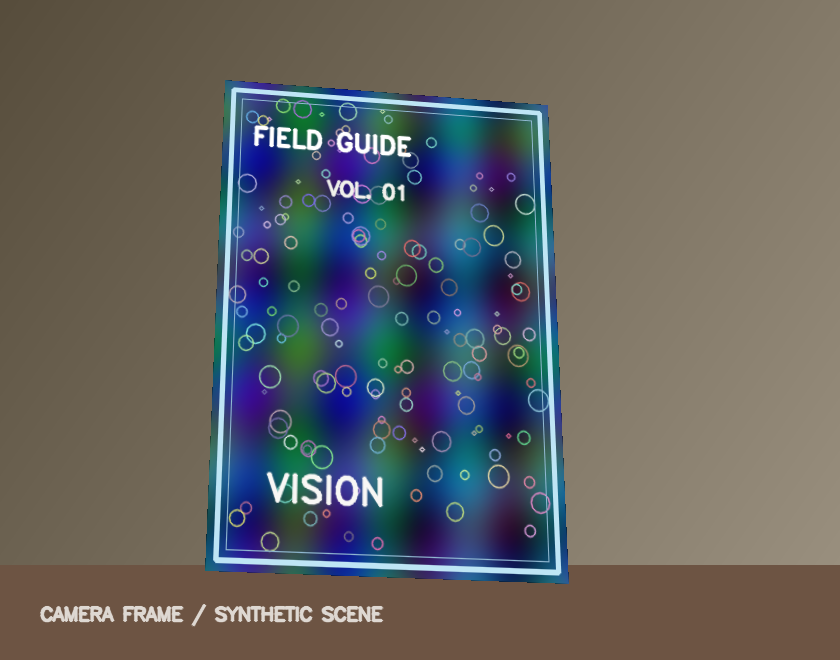
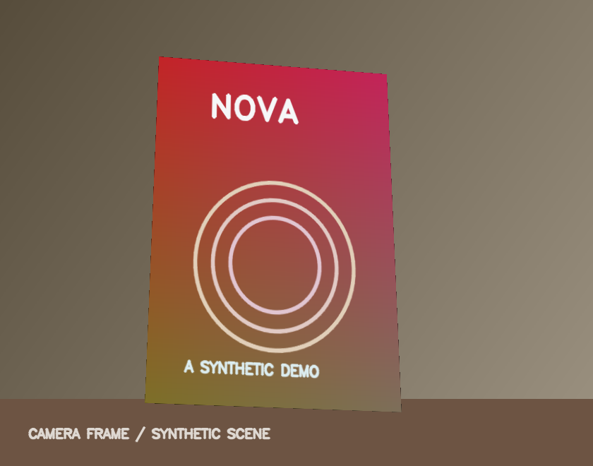
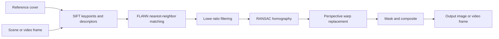

# Book Cover Replacement — Classical Computer Vision

**Detect a known book cover in a photo or video, estimate its perspective, and replace the cover region with another image or moving video content.**

Python · OpenCV · SIFT · FLANN · Lowe's ratio test · RANSAC · Homography · Video processing

> **Portfolio note:** This repository is based on my computer-vision course project. The original experiment used book covers, movie posters, and trailers. Those third-party media assets are **not distributed here**. The public demo below uses original, procedurally generated images and short video clips, so the pipeline can be tested independently.

## Demo — fully synthetic test assets

| Input scene (original synthetic cover) | Output scene (synthetic replacement art) |
|:--:|:--:|
|  |  |

The synthetic demo is generated by [`scripts/make_synthetic_demo.py`](scripts/make_synthetic_demo.py). **It is a smoke test, not a quantitative evaluation of real-world detection accuracy.**

**Video demo:** [input scene](examples/synthetic/input_clip.mp4) · [replacement clip](examples/synthetic/overlay_clip.mp4) · [processed output](examples/synthetic/output_clip.mp4)  
The example contains 12 short frames. The standalone demo was tested successfully on all 12 frames of this synthetic sequence; that does **not** imply 100% accuracy on unseen videos.

## How it works



1. **Localize a known cover.** Extract SIFT features from a reference cover and the input scene/frame, then match descriptors using a FLANN K-D tree matcher.
2. **Reject ambiguous matches.** Apply Lowe's distance ratio and require a minimum number of plausible correspondences.
3. **Estimate geometry.** Fit a projective homography using RANSAC and check that the mapped cover quadrilateral is plausible.
4. **Replace the planar region.** Warp a poster/image—or the next frame from an overlay clip—into the detected cover region and composite using a polygon mask.
5. **Optional foreground preservation (image mode).** A reference/scene pixel-difference heuristic can retain possible occluding objects. It is experimental and may produce artifacts under lighting changes.

For videos, the cover is detected separately in each frame and the replacement clip is looped as needed; it does not implement object tracking or audio preservation.

## Quick start

Requires Python 3.10+ and OpenCV (SIFT is provided by modern OpenCV builds). The demo works on **CPU**, including Intel macOS; no CUDA or model weights are needed.

```bash
python3 -m venv .venv
source .venv/bin/activate
python -m pip install -r requirements.txt
```

**Still-image example:**

```bash
python -m src.cli image \
  --scene examples/synthetic/scene_before.png \
  --cover examples/synthetic/cover_reference.png \
  --poster examples/synthetic/replacement_art.png \
  --output outputs/replaced.png
```

**Video example:**

```bash
python -m src.cli video \
  --input examples/synthetic/input_clip.mp4 \
  --cover examples/synthetic/cover_reference.png \
  --overlay-video examples/synthetic/overlay_clip.mp4 \
  --output outputs/replaced_video.mp4
```

**Run smoke tests:**

```bash
python -m unittest discover -s tests -v
```

**Regenerate the synthetic test assets (optional):**

```bash
python scripts/make_synthetic_demo.py
```

### Using your own media

Provide (1) a clear, textured image of a cover, (2) a photo or video in which **that same cover** is visible, and (3) an image or video to place on the cover. Use files you own or have permission to share. Original third-party book, poster, and film-trailer datasets are not included.

## Original Colab notebooks

The coursework is preserved in two sanitized notebooks; saved outputs and execution metadata were removed to keep this repository lightweight:

- [`notebooks/vision_part1.ipynb`](notebooks/vision_part1.ipynb): photo matching, poster replacement, and an occlusion-preservation heuristic
- [`notebooks/vision_part2.ipynb`](notebooks/vision_part2.ipynb): frame-by-frame video replacement using matching trailer frames

**Important:** These *original notebooks* reference a local Google Drive dataset at `/content/drive/MyDrive/cover_db/`. To rerun them, you must supply the appropriate cover, poster, test-image and video files, or adapt their paths. They are preserved as project evidence, not presented as standalone ready-to-run code. The `src/` implementation is a separate, parameterized CLI adapted from the same approach.

## Repository structure

```text
book-cover-replacement/
├── README.md
├── requirements.txt
├── requirements-notebooks.txt
├── .gitignore
├── src/
│   ├── __init__.py
│   ├── cover_replacer.py        # SIFT, FLANN, RANSAC, warp/compositing
│   └── cli.py                   # Image + video command-line interface
├── notebooks/
│   ├── vision_part1.ipynb       # Original photo workflow (outputs stripped)
│   └── vision_part2.ipynb       # Original video workflow (outputs stripped)
├── examples/
│   └── synthetic/              # Small, generated sample media
├── scripts/
│   └── make_synthetic_demo.py
└── tests/
    └── test_pipeline.py
```

## Reproducibility and limitations

- The cleaned CLI and 12-frame synthetic demo were smoke-tested with **Python 3.11, OpenCV 4.13, and NumPy 2.3**. These checks verify that the flow runs; they are not an accuracy benchmark.
- Detection requires adequate SIFT features and a sufficiently visible reference cover. Heavy blur, viewpoint changes, glare, and large occlusions can make matching fail.
- Optional occlusion preservation is heuristic rather than a learned segmentation method. It is not enabled by default in the CLI.
- The video path processes frames independently and generates a **silent** MP4, with no audio muxing or temporal tracking.
- Original movie posters, trailers, and real-world image assets are not included. The course report is not included because it contains third-party artwork; a permissions-cleared report or media set can be added later.
- No numerical accuracy or FPS benchmark on a real-world evaluation set is claimed.

## Author

**Reyhaneh Rezaei**  
M.Sc. student, Artificial Intelligence — Ferdowsi University of Mashhad

A software license has not been selected yet. Reuse permissions should be decided before adding a license file.
