# Book Cover Replacement — Classical Computer Vision

**Book-cover detection and perspective-aware image/video replacement using SIFT, FLANN, RANSAC homography, and OpenCV.**

Python · OpenCV · Feature Matching · Homography · Image Compositing · Video Processing

> **Project evidence:** The **Original experiment results** below come from my own completed computer-vision coursework experiments, not from synthetic or AI-generated examples. The photos, processing runs, and resulting video composites were created by me. Some book covers, posters, and video imagery incorporated in the experiments originate from third-party media; please see the [media notes](docs/media_provenance.md).

## Original experiment results — image replacement

The following are **actual outputs saved in my original `vision_part1.ipynb` notebook**. The left images show detected covers (green homography outlines), and the right images show their corresponding poster replacements. They are included without pixel-level modification.

| Detected cover — original result | Replaced cover — original result |
|:--:|:--:|
| 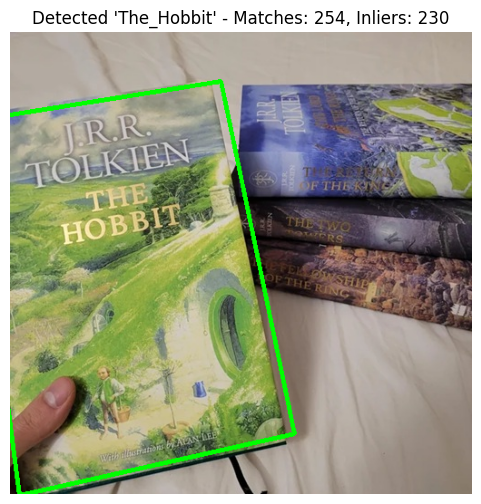 | 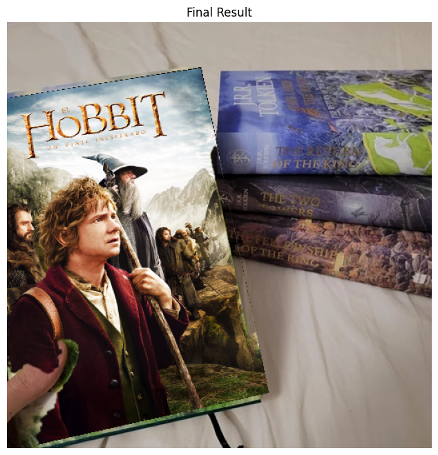 |
| 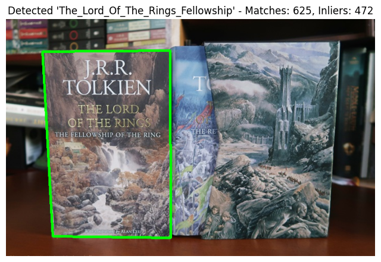 | 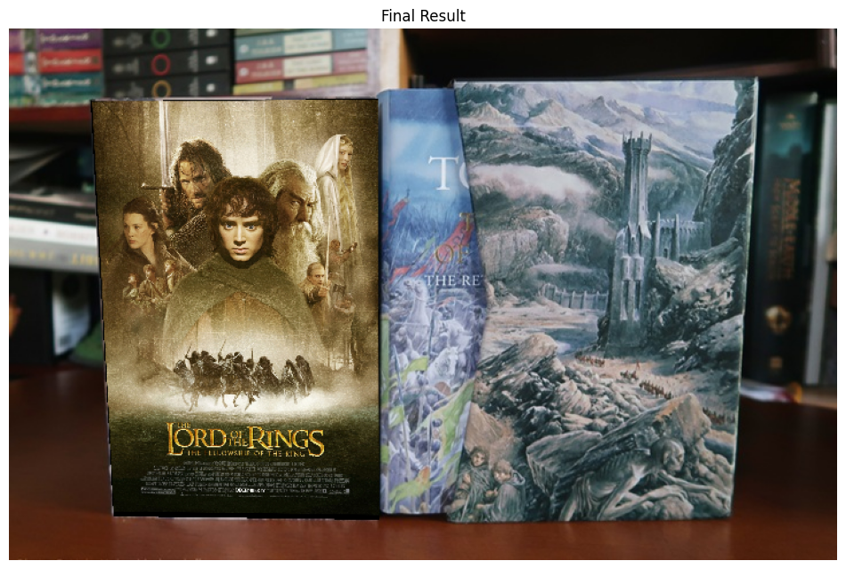 |

<details>
<summary><strong>View more original image results (4 more before/after pairs and one detection-only result)</strong></summary>

| Detected cover | Replacement result |
|:--:|:--:|
| 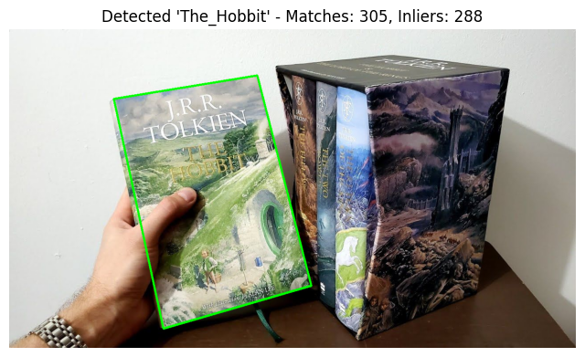 | 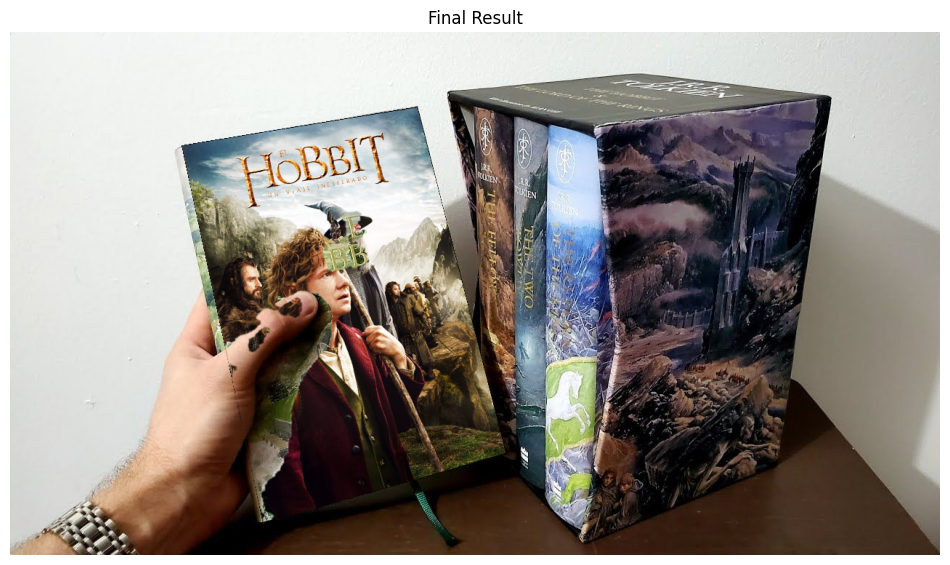 |
| 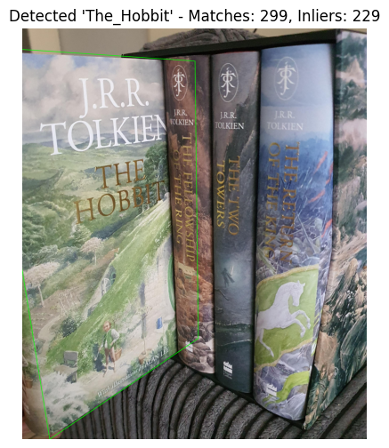 | 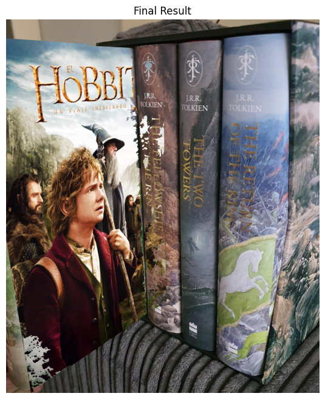 |
| 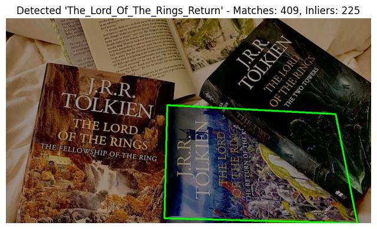 | 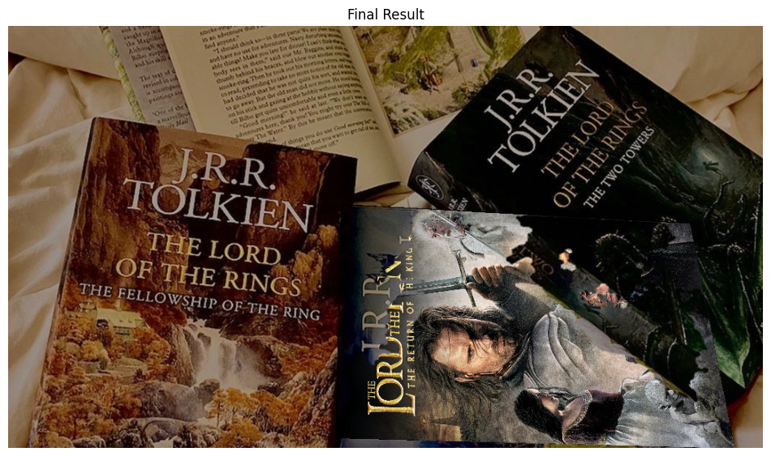 |
| 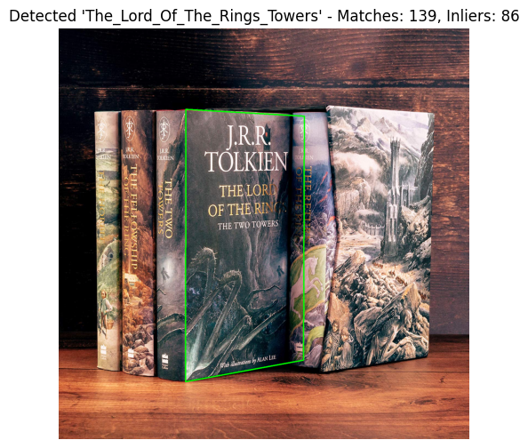 | 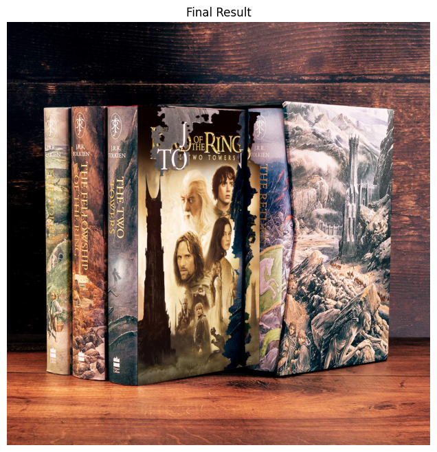 |

**Additional detection-only notebook output:** [Fellowship cover detection](examples/original/images/fellowship_1_detection.png). There was no corresponding saved final replacement image for that particular case in the supplied notebook.

</details>

## Original experiment results — video replacement

These clips are **full-duration, compressed exports of the five real video-processing results** I produced for the course project. They are not simulated animations. They have been re-encoded at reduced resolution (540 × 960) for convenient GitHub viewing; the original 1080 × 1920 files remain in my original coursework archive. The original outputs contain no audio.

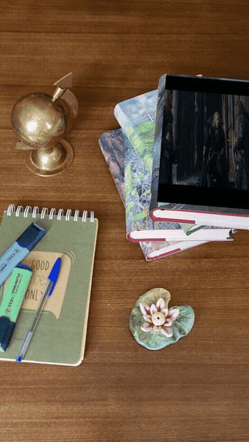

*GIF: a short, silent preview extracted from the real `The_Lord_Of_The_Rings_Towers.mp4` experiment result.*

| Result video | Watch the full processed clip |
|:--|:--|
| The Fellowship of the Ring | [Full processed video (MP4)](examples/original/videos/The_Fellowship_Of_The_Ring.mp4) |
| The Hobbit | [Full processed video (MP4)](examples/original/videos/The_Hobbit.mp4) |
| The Girl with the Dragon Tattoo | [Full processed video (MP4)](examples/original/videos/The_Girl_With_Dragon_Tattoo.mp4) |
| The Lord of the Rings — Towers | [Full processed video (MP4)](examples/original/videos/The_Lord_Of_The_Rings_Towers.mp4) |
| The Lord of the Rings — Towers (second run) | [Full processed video (MP4)](examples/original/videos/The_Lord_Of_The_Rings_Towers2.mp4) |

<details>
<summary><strong>View still frames captured from the real result videos</strong></summary>

| The Fellowship of the Ring | The Hobbit | The Girl with the Dragon Tattoo |
|:--:|:--:|:--:|
| 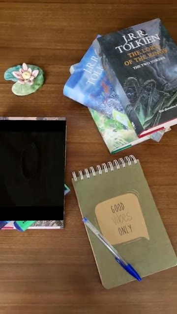 | 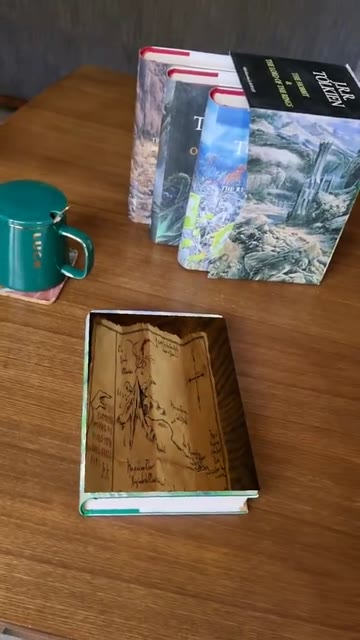 | 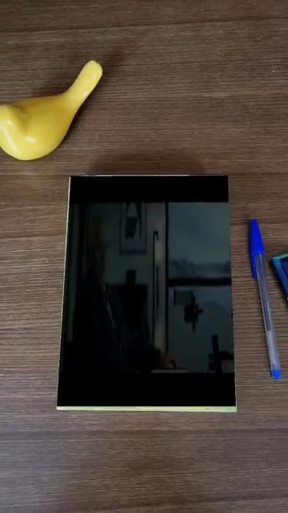 |

| Towers — run 1 | Towers — run 2 |
|:--:|:--:|
| 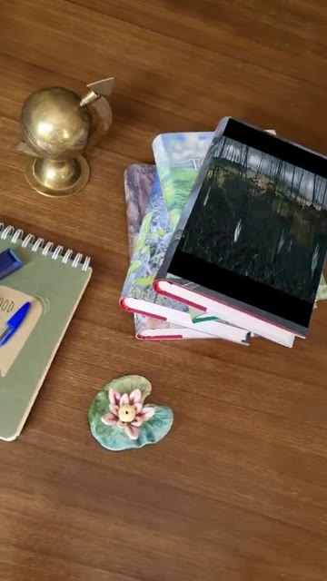 | 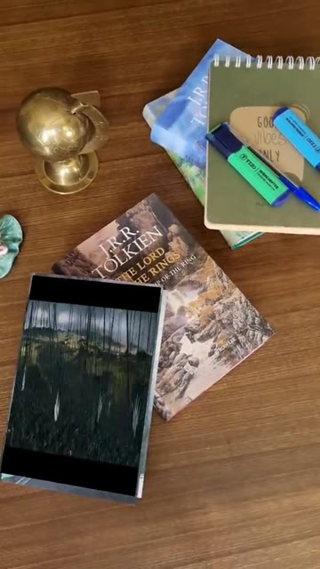 |

**Original video-notebook output:** [saved frame montage](examples/original/images/video_notebook_frame_montage.png).

</details>

**About provenance:** The 14 notebook images above were extracted from saved outputs in the original notebooks without modification. The five MP4 files, preview frames, and GIF were transcoded/extracted from the five original output videos; see the [detailed provenance and media notes](docs/media_provenance.md). The original full-resolution versions are not committed due to repository size.

## How it works

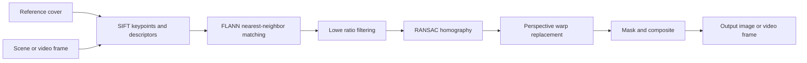

1. **Detect a known cover:** extract SIFT descriptors from the reference cover and a photograph or frame.
2. **Match robustly:** use FLANN matching, Lowe's ratio test, and RANSAC to estimate a homography.
3. **Overlay the replacement:** warp replacement imagery to the detected cover plane and composite the result using a mask.
4. **Handle occlusion (original image notebook):** explore a heuristic for preserving foreground objects when a hand or other object covers part of the target surface.
5. **Process video:** repeat per-frame detection and alignment and use frames from a replacement video for the overlay.

The original experiments are preserved as notebooks, while the separate CLI provides a lightweight, parameterized implementation of the core approach.

## Code and reproducible test demo

This repository also contains a **separate synthetic smoke test** for developers who want to run the code without the original book/poster/video sources. These procedurally generated files under `examples/synthetic/` are **not original experiment results** and should not be confused with the portfolio examples above.

The standalone demo runs on CPU and can be used on Intel macOS.

```bash
python3 -m venv .venv
source .venv/bin/activate
python -m pip install -r requirements.txt
```

**Image replacement smoke test:**

```bash
python -m src.cli image \
  --scene examples/synthetic/scene_before.png \
  --cover examples/synthetic/cover_reference.png \
  --poster examples/synthetic/replacement_art.png \
  --output outputs/replaced.png
```

**Video replacement smoke test:**

```bash
python -m src.cli video \
  --input examples/synthetic/input_clip.mp4 \
  --cover examples/synthetic/cover_reference.png \
  --overlay-video examples/synthetic/overlay_clip.mp4 \
  --output outputs/replaced_video.mp4
```

**Run smoke tests:**

```bash
python -m unittest discover -s tests -v
```

<details>
<summary>View synthetic test example (not original coursework result)</summary>

| Synthetic input | Synthetic output |
|:--:|:--:|
|  |  |

</details>

## Original course notebooks

- [`notebooks/vision_part1.ipynb`](notebooks/vision_part1.ipynb): SIFT-based image matching, poster replacement, and occlusion-preservation experiments.
- [`notebooks/vision_part2.ipynb`](notebooks/vision_part2.ipynb): frame-wise book-cover replacement with video imagery.

The original notebooks used local files under `/content/drive/MyDrive/cover_db/`. The included cleaned notebooks have had saved outputs removed to keep their code readable and the repository light. The actual saved output images are now published separately above. To rerun the original notebooks, the corresponding private inputs or adapted file paths are needed.

## Repository structure

```text
book-cover-replacement/
├── README.md
├── docs/
│   └── media_provenance.md
├── examples/
│   ├── original/
│   │   ├── images/          # 14 genuine saved notebook outputs
│   │   ├── videos/          # 5 full-duration compressed real result videos
│   │   └── previews/        # Real-video stills + animated excerpt
│   └── synthetic/           # Separate reproducibility smoke-test assets
├── notebooks/
│   ├── vision_part1.ipynb
│   └── vision_part2.ipynb
├── src/
│   ├── cover_replacer.py
│   └── cli.py
├── scripts/
│   └── make_synthetic_demo.py
├── tests/
│   └── test_pipeline.py
├── requirements.txt
└── requirements-notebooks.txt
```

## Limitations and reproducibility

- **Original results vs. new experiments:** the photos and video links above represent the user's previously completed coursework experiments. They are not new runs of the cleaned CLI.
- The parameterized CLI was smoke-tested on synthetic data. That is a functional check, not a real-world benchmark or quantitative accuracy estimate.
- SIFT matching can fail with blur, glare, small visible target regions, severe occlusion, or large viewpoint changes.
- The original image notebook's occlusion-handling is heuristic, not a general segmentation model.
- The video pipeline processes frames separately; it does not claim robust temporal tracking or audio synchronization.
- Some sample composites incorporate third-party cover, poster, or film imagery. Their inclusion documents the computer-vision experiments, but **creation of the composites alone does not establish publishing rights to the underlying media**. Review those rights before sharing or redistributing.
- No quantitative detection accuracy or FPS benchmark on a held-out real-world dataset is claimed.

## Author

**Reyhaneh Rezaei**  
M.Sc. student in Artificial Intelligence — Ferdowsi University of Mashhad

No software license has been chosen. A license for source code, if added later, should not be interpreted as a license for third-party media assets.
